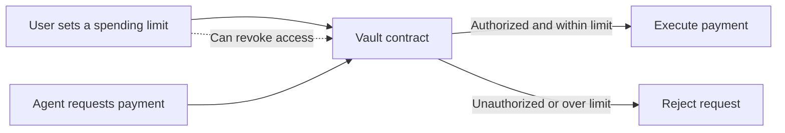

# Android Systems & Developer Tools

I've spent over a decade building Android software, with a focus on system stability and how phones connect to in-car systems. This profile collects my public tools and engineering experiments.

**VS Code extensions** · [CSV editing and virtual scrolling](https://github.com/HOLYGITHUBUSER/vscode_csv_reader) · [Markdown and Mermaid preview](https://github.com/HOLYGITHUBUSER/vscode_md_reader) · [YAML tree and source navigation](https://github.com/HOLYGITHUBUSER/vscode_yaml_reader)

## AgentVault · Who sets the spending limit?

[**AgentVault**](https://github.com/HOLYGITHUBUSER/hecthon_monad_hangzhou_20260413) was an entry in the Agentic Payment track at **Monad Blitz Hangzhou V2**. On the Monad testnet, a user authorizes an agent and sets its spending limit. The agent can request payments, but the vault contract enforces the limit. The user can revoke access.

[Smart contracts](https://github.com/HOLYGITHUBUSER/hecthon_monad_hangzhou_20260413/tree/HEAD/contracts-%E5%90%88%E7%BA%A6) · [MCP server](https://github.com/HOLYGITHUBUSER/hecthon_monad_hangzhou_20260413/tree/HEAD/mcp-server-MCP%E6%9C%8D%E5%8A%A1%E5%99%A8)

## Toolbox

- **AI workflows** · [HarnessEngineering](https://github.com/HOLYGITHUBUSER/HarnessEngineering) collects reusable skills, commands, and rules for recurring engineering tasks. Start with the [skills directory](https://github.com/HOLYGITHUBUSER/HarnessEngineering/tree/HEAD/skills).
- **Android / Kotlin** · [PermissionLibX](https://github.com/HOLYGITHUBUSER/PermissionLibX) wraps Android runtime permission requests so screens can focus on what happens after access is granted.
- **Browser extensions** · [Dark Mode Extension](https://github.com/HOLYGITHUBUSER/safari_darkmode_extension) adapts websites for dark mode. The screenshots show the same page before and after.

| Default appearance | Dark mode enabled |
| :---: | :---: |
|  |  |

### Technical focus

**Mobile:** Android, Kotlin, permissions, and system stability.  
**Developer tools:** TypeScript, VS Code extensions, webviews, and virtualized lists.  
**Agent engineering:** Agent Skills, MCP, Solidity, and on-chain authorization.

## GitHub Activity

 

[View contribution activity on GitHub →](https://github.com/HOLYGITHUBUSER#js-contribution-activity)

**Contact** · For bugs and feature requests, open an issue in the relevant repository. For other public questions, [start here](https://github.com/HOLYGITHUBUSER/HOLYGITHUBUSER/issues/new).
